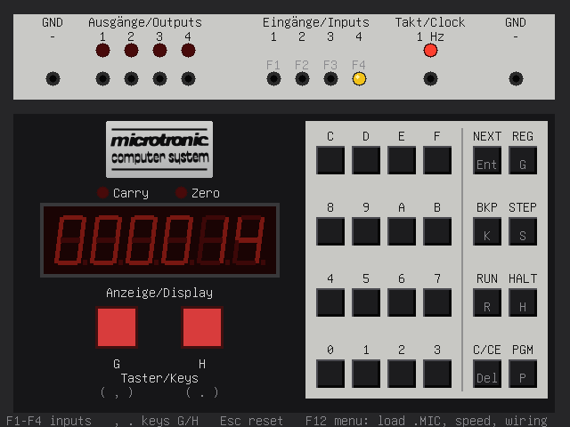

# Busch Microtronic 2090 for MiSTer

The Busch Microtronic 2090 (1981), a 4-bit educational computer, as a
[MiSTer](https://github.com/MiSTer-devel/Main_MiSTer/wiki) core. It runs the
original TMS1600 firmware ROM; the 2114 program memory, keypad, six-digit display,
inputs, outputs, carry/zero LEDs and the 1 Hz clock are wired as on the real board.

The CPU and board are a port of the
[browser emulator](https://lambdamikel.github.io/microtronic-emulator/)
([source](https://github.com/lambdamikel/microtronic-emulator)), and they are
checked against it instruction by instruction (see *Verification*).



This is version 1.0; the F12 menu shows the version and build date.

## Installation

- Copy `releases/Microtronic_<date>.rbf` to `_Computer/` on the SD card.
- Copy `dist/games/Microtronic/` to `games/Microtronic/`: 37 programs from the
  Busch manuals, the programmer's guide, and Björn Rathje's games.

## Keys

| PC key | Microtronic |
|---|---|
| `0`–`9`, `A`–`F` (and the keypad digits) | hex keys |
| `H` | HALT |
| `N`, `Enter`, `Space` | NEXT |
| `R` | RUN |
| `S`, `T` | STEP |
| `K` | BKP |
| `G` | REG |
| `P` | PGM |
| `Backspace`, `Delete`, `X` | C/CE |
| `,` and `.` | the red keys G and H |
| `F1`–`F4` | switch inputs 1–4 high or low |
| `Esc` | reset |
| `F12` | MiSTer menu |

These are the same keys as in the browser emulator. A key tap is held for at
least 5,000 instruction cycles (60 ms), so the firmware's keypad scan always sees it.

## Menu

- **Load program**: a `.MIC` file. This is the text format of the
  [Busch-2090 software archive](https://github.com/lambdamikel/Busch-2090/tree/master/software):
  `#` or `;` start comments, `@ hh` sets the address, and every three-digit
  hex word is one instruction. The core parses the file in hardware as it
  streams in and writes it into the 2114. Then start it as usual, e.g.
  `HALT NEXT 0 0 RUN`.
- **Speed**: Original (83,333 instruction cycles per second), 4×, 16× or ¼×.
- **1 Hz clock cable to**: plug the clock output into input 1–4.
- **Red key G / H wired to**: which input each red key pulls high (by default G
  goes to input 1 and H to input 2, as in the browser emulator).
- **Piezo buzzer on**: the buzzer block on output 1–4, a 2.4 kHz tone while the
  output is high.
- **Patch cable from / to**: an output-to-input cable.

Every program file that needs wiring says so in its second line, for example
`# MiSTer menu: Piezo buzzer on = Output 1; 1 Hz clock cable to = Input 4`.

## Screen

The picture is drawn at 640×480. It has the I/O strip with the output LEDs
and the input jacks (a yellow plug shows a high input), the 1 Hz LED, the badge
(the lettering traced from a photo of the real one, as in the browser emulator; `tools/mkbadge.py`),
the carry/zero LEDs, and the slanted red six-digit display. Below are the red
keys G/H and the keypad, where held keys light up. Display segments and LEDs show
how long they were on (averaged over 2,048 instruction cycles), so the multiplexed
display and dimmed LEDs look as they do on the real thing.

## Not (yet) included

- The tone circuit (multivibrator) and the PicoRAM 2090 sound extension,
  so the programs that need them are left out of `games/Microtronic`.
- The 2095 cassette interface.
- Saving programs.

## Verification

`sim/` holds a lockstep test. One stimulus script (key presses, input levels,
the clock and patch cables, program loads, warm resets) drives both the
browser emulator's JavaScript core (`jsref.sh`, in headless Chrome) and this
Verilog in Verilator (`tb_lockstep.cpp`). Both chain a hash of the CPU state
after every instruction, and print it along with RAM and 2114 hashes at
checkpoints. All six scenarios (boot, keypad entry, guide programs, inputs
with clock and patch cables, built-in PGM programs, Blockade and Lunar
Lander) match at every checkpoint, about 5 million instructions in all.

`sim/check_loader.py` streams `.MIC` files through the hardware loader. It checks
that each one ends up in the 2114 exactly as the browser emulator's parser would
put it: all 37 files in `dist/` and all 27 in the Busch-2090 archive pass.
`sim/tb_video.cpp` renders frames to PPM files (the screenshot above is one).

The scripts expect clones of
[microtronic-emulator](https://github.com/lambdamikel/microtronic-emulator) and
[Busch-2090](https://github.com/lambdamikel/Busch-2090) next to this repository; set
`MICROTRONIC_EMU` and `BUSCH2090` to use other paths. `jsref.sh` needs Google Chrome,
the rest Verilator.

```
sim/mkscen.py                         # write the scenarios
verilator ... --top-module microtronic rtl/microtronic.v rtl/tms1600.v sim/tb_lockstep.cpp
sim/obj/tb_lockstep sim/scen_keys.txt > v.txt; sim/jsref.sh sim/scen_keys.txt > j.txt; diff v.txt j.txt
```

## Building

Quartus Prime Lite 17.0 (as for all MiSTer cores): open `Microtronic.qpf` and
compile, or run `quartus_sh --flow compile Microtronic`. The framework in
`sys/` comes from [Template_MiSTer](https://github.com/MiSTer-devel/Template_MiSTer).

## Credits

- Michael Wessel: the browser emulator this core is ported from, and the ROM dump and Microtronic Phoenix
  ([Busch-2090](https://github.com/lambdamikel/Busch-2090),
  [microtronic-phoenix](https://github.com/lambdamikel/microtronic-phoenix)).
- Jason T. Jacques: the TMS1000-family emulator whose semantics the CPU follows.
- Björn Rathje: Kniffel, Mensch ärgere dich nicht and Monarch, included with his permission.
- The 8×16 font is misc-fixed (public domain).
- Made with Claude Opus 5.5 (Claude Code), together with Michael Wessel.

The core is GPL-3. The MiSTer framework in `sys/` keeps its own licence (GPL-2 or later).
The Microtronic firmware ROM (`rtl/microtronic_rom.hex`) remains
© Busch and is not covered by the licence; neither are Björn Rathje's programs.
